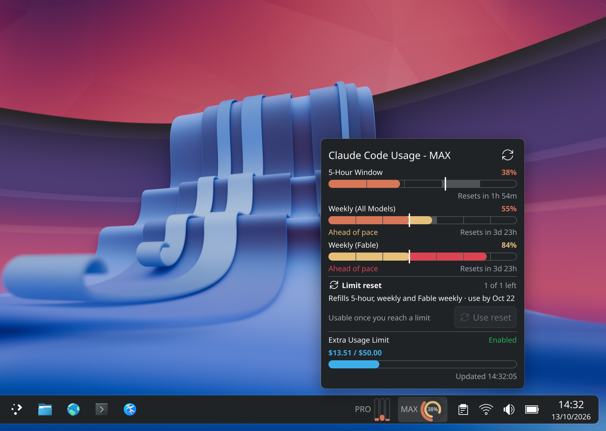
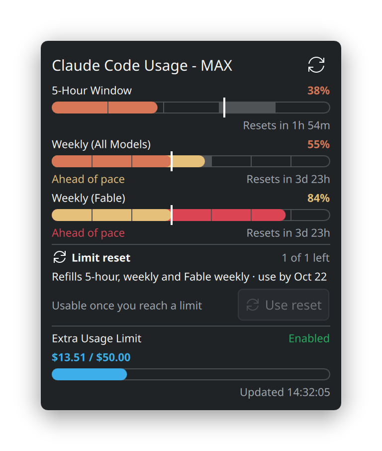
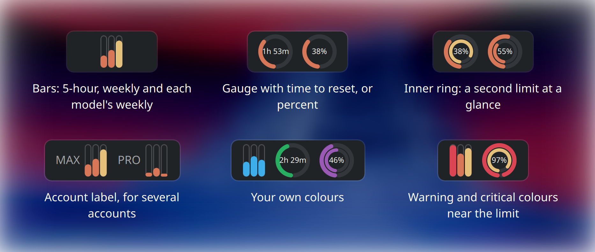

# Claude Meter

[](https://store.kde.org/p/2348058/)
[](https://kde.org/plasma-desktop/)
[](https://github.com/p3kj/plasma-applet-claudemeter/releases/latest)
[](LICENSE)
[](https://github.com/p3kj/plasma-applet-claudemeter/commits/master)

A KDE Plasma 6 panel applet that monitors your Claude Code rate limits.



## Features



- Displays the 5-hour and 7-day (all models) rate limit windows
- Adds a separate bar for every scoped weekly limit the API reports (e.g. Fable), discovered dynamically so new models and plan tiers work without an update
- Popup bars show your pace: each bar is split into its hours or days, a marker tracks the current time, and usage that has run past that marker is drawn in the warning color
- Shows the usage-limit reset claude.ai offers under Settings > Usage (what it refills, how many are left, the deadline) and lets you spend it from the popup, always behind a confirmation step. The widget never uses a reset on its own
- Can let Claude Code refresh its expired token by running it for a second, so the widget keeps working while you only use Claude on the web. A button in the popup, or automatic when you turn it on (see [Automatic token refresh](#automatic-token-refresh-optional))
- Two compact panel styles: stacked bars or circular gauge, with an optional inner ring for a second limit
- Monitors several accounts side by side, one widget per Claude folder, each with its own short label
- Configurable warning/critical thresholds with color coding
- Customizable bar colors
- Auto-refreshes on a configurable polling interval
- Warning icon when credentials are missing or the API returns an error



## How It Works

1. Reads the OAuth token from `.credentials.json`, created by the Claude Code CLI when you sign in. It checks `$CLAUDE_CONFIG_DIR` first when that variable is exported, then `~/.claude`, then a single `~/.claude*` sibling folder if exactly one has credentials. Setting **Claude folder** in the widget overrides all of it
2. Calls `GET https://api.anthropic.com/api/oauth/usage?cedar_ember=1` with a bearer token. It identifies itself as the Claude Code CLI, because the server only lists reset grants for Claude Code and claude.ai
3. Parses the response for the 5-hour and 7-day windows, plus every scoped weekly limit in the `limits` array that has a reset time or non-zero utilization (the older top-level `seven_day_*` fields are still read as a fallback)
4. The token is passed to `curl` via stdin (not as a command-line argument, which would be visible in `/proc`)
5. Using a reset sends `POST /api/organizations/<org>/reset_rate_limits`, the same request Claude Code's `/limit-reset` makes. The organization id comes from Claude Code's `.claude.json`
6. An expired token is only ever refreshed by Claude Code itself, which the widget can run for a second. The widget never calls the OAuth token endpoint

> **Note:** This widget uses an internal Anthropic API endpoint that is not part of the public API documentation. It may change or stop working without notice.

## Requirements

- KDE Plasma 6
- Claude Code CLI signed in with a Claude plan (Pro, Max or Team)
- `python3`
- `curl`

## Install

### From the KDE Store

Browse to [Claude Meter on the KDE Store](https://store.kde.org/p/2348058/) and click **Install**, or use Discover (KDE's software center) to search for "Claude Meter".

### From source

```sh
git clone https://github.com/p3kj/plasma-applet-claudemeter.git
cd plasma-applet-claudemeter
bash install.sh
```

Then add the "Claude Meter" widget to your panel.

## Uninstall

```sh
kpackagetool6 -t Plasma/Applet -r com.github.p3kj.claudemeter
```

## Configuration

Right-click the widget and select "Configure...". Options include:

- **Panel style** - bars (stacked) or gauge (circular arc)
- **Gauge metric** - 5-hour window, 7-day (all models), or the most-utilized scoped weekly
- **Inner ring** - a second, thinner arc inside the gauge for another metric (default: the top scoped weekly). Hidden when there is no such limit, when it would duplicate the gauge metric, or on a panel too thin for two rings
- **Show pace against the limit** - segment each popup bar into its hours or days and mark where the current time falls, so a high number early in the window reads differently from the same number late in it. Usage past the marker is drawn in the warning color and labelled "Ahead of pace" (default: on)
- **Poll interval** - how often to fetch usage data (default: 900s)
- **Warning / Critical thresholds** - percentage thresholds for color changes
- **Colors** - customize the normal and warning bar colors
- **Claude folder** - path to an alternate Claude config folder (default: `~/.claude`). Useful if you run multiple accounts via `CLAUDE_CONFIG_DIR`, e.g. `~/.claude-personal`. Add one widget instance per account to monitor them side by side
- **Account label** - a short text such as MAX or PRO, shown in the panel next to the bars or gauge (not in vertical panels), in the tooltip and in the popup title, so instances for different accounts can be told apart (default: empty)
- **Expired token: Let Claude Code refresh it automatically** - when Claude Code's token has expired, run `claude --init-only` for a second so Claude Code refreshes it, at most every 30 minutes per account. See [Automatic token refresh](#automatic-token-refresh-optional) (default: off)

## Automatic token refresh (optional)

The widget reads Claude Code's token, which lasts about 8 hours, and only Claude Code refreshes it. If you use Claude only on the web or in the desktop app for a while, the widget stops at "OAuth token has expired" until you run `claude` again. The widget can run Claude Code briefly to do that for you. It never signs in by itself and never writes your credentials: Claude Code refreshes its own token, as it does whenever you start it.

It is off by default. Whenever the token has expired and can be refreshed, the popup offers a **Refresh token** button. Turn on **Expired token: Let Claude Code refresh it automatically** in the widget settings to have the widget do the same on its own.

### When it runs

- Only when a fetch finds the token expired and the credentials file has a refresh token (and, if the file says when that refresh token expires, the time has not passed yet). A token from `CLAUDE_CODE_OAUTH_TOKEN` is never involved.
- Automatically at most once every 30 minutes per Claude folder, counted from the last try and shared by all widget instances, however the folder setting is spelled. After an automatic try that did not refresh the token, the wait doubles (1 hour, 2 hours, 4 hours and so on, up to a day) until one works. The popup shows when the next try is due.
- **Refresh token** skips that wait. A click that does not work keeps the current wait length, counted from the click, and one that works resets it to 30 minutes.
- Never twice at once for the same folder, and not while a running Claude Code is refreshing the same token itself (its `.oauth_refresh.lock` is less than a minute old).
- When it worked, the widget reads your usage again straight away, once. When it did not, the popup says why and what to do next.

### What it runs

From an empty folder of its own, `~/.cache/claudemeter/claude-renew` (mode 700):

```sh
CLAUDE_CONFIG_DIR=<your Claude folder> \
DISABLE_AUTOUPDATER=1 \
CLAUDE_CODE_DISABLE_NONESSENTIAL_TRAFFIC=1 \
CLAUDE_CODE_SKIP_PROMPT_HISTORY=1 \
timeout -k 5 60 claude --init-only --safe-mode --strict-mcp-config </dev/null >/dev/null 2>&1
```

- `--init-only` runs Claude Code's startup, which includes refreshing an expired token, and exits. `--safe-mode` turns off CLAUDE.md, skills, plugins, hooks and MCP servers, and `--strict-mcp-config` ignores every MCP config file.
- The folder must be empty. If anything is in it, Claude Code is not started and the popup says so: without a terminal, Claude Code does not ask whether to trust a folder, so settings planted there (such as `.claude/settings.json`) would apply.
- `claude` is looked up on `PATH`, then in `~/.local/bin`.
- `CLAUDE_CONFIG_DIR`: if your session already sets it to this same folder, it is passed on as it is. Otherwise, for `~/.claude` it is left unset, because setting it, even to the default folder, makes Claude Code look for its settings in `~/.claude/.claude.json` instead of `~/.claude.json`. For any other folder it is set to that folder.
- The rest of your session environment is passed on, so proxy settings keep working, except variables that would make Claude Code use another credential or provider, skip its refresh lock, or act as if it ran inside another session: `CLAUDE_CODE_OAUTH_TOKEN`, `CLAUDE_CODE_OAUTH_TOKEN_FILE_DESCRIPTOR`, `CLAUDE_CODE_OAUTH_REFRESH_TOKEN`, `CLAUDE_CODE_API_KEY_FILE_DESCRIPTOR`, `CLAUDE_CODE_GATEWAY_TOKEN_FILE_DESCRIPTOR`, `CLAUDE_CODE_WEBSOCKET_AUTH_FILE_DESCRIPTOR`, `ANTHROPIC_API_KEY`, `ANTHROPIC_AUTH_TOKEN`, `ANTHROPIC_AWS_API_KEY`, `ANTHROPIC_FOUNDRY_API_KEY`, `ANTHROPIC_FOUNDRY_AUTH_TOKEN`, `CLAUDE_CODE_USE_BEDROCK`, `CLAUDE_CODE_USE_VERTEX`, `CLAUDE_CODE_USE_FOUNDRY`, `CLAUDE_CODE_USE_GATEWAY`, `CLAUDE_CODE_USE_MANTLE`, `CLAUDE_CODE_SDK_HAS_OAUTH_REFRESH`, `CLAUDE_CODE_SDK_HAS_HOST_AUTH_REFRESH`, `CLAUDE_CODE_DISABLE_AUTH_REFRESH_LOCK`, `CLAUDECODE`, `CLAUDE_CODE_ENTRYPOINT` and `CLAUDE_CODE_CHILD_SESSION`.
- It takes about a second. After 30 seconds it is stopped, along with anything it started (TERM, then KILL 5 seconds later). If Claude Code is in the middle of refreshing at that point (its `.oauth_refresh.lock` is fresh), it gets up to 15 seconds more, since stopping it halfway could sign you out.
- `timeout -k 5 60` is a safety net for when the widget itself goes away mid-run: Plasma then kills the widget's script outright, and `timeout` still stops Claude Code. Normally the script stops it well before that.
- Its output is discarded, never shown or logged.

Tested with Claude Code 2.1.296.

### What it does not do

- No prompt and no model request, so no usage is spent
- No MCP servers, hooks or plugins. Your user settings still apply as on any Claude Code start, including ones that run commands, such as `apiKeyHelper` or `awsAuthRefresh`
- In testing it left no session transcript, no `history.jsonl` entry (so the widget's activity check does not fire either) and no project entry for its folder, and it cleaned up its session file. The new token lands in the credentials file, written by Claude Code itself, and Claude Code may update its own bookkeeping, as on any start
- The widget never uses, prints or passes on the tokens. It looks only at the expiry times and whether a refresh token exists, and it never calls the OAuth endpoint: refresh tokens rotate, and writing new ones back could race a running Claude Code and sign you out

Apart from that, the widget keeps a lock file and a small state file (time of the last try, tries in a row that did not work) for each Claude folder in `~/.cache/claudemeter/` (`renew_<id>.lock`, `renew_<id>.json`).

### Turning it off

Untick **Expired token: Let Claude Code refresh it automatically** in the widget settings (it stays off unless you turned it on). The widget then never starts Claude Code by itself: only a click on **Refresh token** does.

## Troubleshooting

- **Widget shows a warning icon** - make sure you are signed into the Claude Code CLI (`claude` in a terminal). The widget reads your OAuth token from `~/.claude/.credentials.json`, which is created on sign-in.
- **"No .credentials.json in ..."** - the sign-in token file is not where the widget looked. Note that `~/.claude.json` is *not* it: that file only holds account metadata (email, organization, plan), never the token. Common causes:
  - You set `CLAUDE_CONFIG_DIR` in your shell profile. plasmashell does not read your shell profile, so put the same path into the widget's **Claude folder** setting (or export the variable session-wide, e.g. in `~/.config/plasma-workspace/env/`).
  - You authenticate with `ANTHROPIC_API_KEY`, `ANTHROPIC_AUTH_TOKEN`, `apiKeyHelper`, Bedrock, Vertex, or Foundry instead of `claude /login`. No credentials file is written in those setups, and the widget cannot work from those credentials: `/api/oauth/usage` is subscription-scoped and needs an OAuth bearer token carrying the `user:profile` scope, which a Console API key does not have. A `claude setup-token` credential does not help either, since [it can only make model requests](https://code.claude.com/docs/en/authentication#generate-a-long-lived-token). Sign in with `claude` to get a token the widget can use.
  - You signed out and have not signed back in.
- **"Several accounts found ..."** - two or more `~/.claude*` folders each hold credentials, and the widget will not guess between them. Set **Claude folder** to the one you want. Add a second widget instance pointed at the other folder to watch both.
- **"OAuth token has expired"** - Claude Code refreshes its token, which lasts about 8 hours, only while it runs. Run `claude` once, click **Refresh token** in the popup, or turn on [automatic token refresh](#automatic-token-refresh-optional). When a refresh fails, the popup says why:
  - "was not found" - `claude` is neither on plasmashell's `PATH` nor in `~/.local/bin`. Check that Claude Code is installed.
  - "did not refresh the token" - usually the sign-in itself has lapsed. Run `claude` in a terminal and sign in again if it asks.
  - "cannot be refreshed automatically", or no **Refresh token** button - the credentials file has no refresh token, or that has expired too. Run `claude` in a terminal to sign in again.
  - "must be empty" - something is in `~/.cache/claudemeter/claude-renew`. Check what it is, then empty the folder.
- **"API returned HTTP 401"** - the server rejected a token the credentials file still calls valid, for example after you signed out elsewhere. Run `claude` in a terminal and sign in again if it asks. The token refresh does not help here: it only steps in once the file says the token has expired.
- **429 "Too Many Requests" errors** - the Anthropic API rate-limits usage polling. The default 15-minute interval should be safe, but if you set a very short poll interval you may get throttled. Increase the interval in the widget configuration if this happens.

## Development

Tasks are driven by [just](https://github.com/casey/just):

```sh
just              # list the recipes
just check        # validate metadata, config schema, shell scripts and QML, then build
just test-renew   # test the token refresh against a stub claude in a throwaway HOME
just reinstall    # install into the running session and restart plasmashell
just run          # open the widget standalone
```

`just reinstall` restarts plasmashell on purpose: after a reinstall the panel keeps
running the previously cached QML, so a plain `install.sh` can look like your change
did nothing.

### Releasing

Record changes as you go, then cut the release:

```sh
just note "Add a thing"      # appends a bullet under "## Unreleased" in CHANGELOG.md
just release minor           # patch | minor | major, or an explicit 1.0.0
```

`just release` runs the preflight checks (on `master`, no stray changes, in sync with
the remote, tag unused, `gh` authenticated), lints, shows what it is about to do and
asks for confirmation. It then writes the version into `metadata.json`, dates the
changelog section, builds `dist/claudemeter-<version>.plasmoid`, commits, creates an
annotated tag, pushes, and publishes a GitHub release with the archive attached.

Two deliberate holes in the "clean tree" check: an uncommitted `CHANGELOG.md` is fine,
because the release commit picks it up, so `just note` straight into `just release`
works. And untracked files elsewhere in the repo (design sources, screenshots) are
ignored, since they cannot end up in the archive. An untracked file *inside* the
packaged set does stop the release, because it would otherwise ship to the store
without ever being committed.

`DRY_RUN=1 just release patch` does all of that locally but skips the push, the GitHub
release and the browser. Undo it with `git tag -d v<version> && git reset --hard HEAD~1`.

The KDE Store is the one step that cannot be automated: its OCS API is read-only, so
there is no way to upload a new file or set a version over HTTP. The release recipe
therefore ends by opening the [store edit page](https://store.kde.org/p/2348058/edit)
and `dist/` in a file manager, and putting the release notes on your clipboard, leaving
you the upload, the version field and a save.

## License

[MIT](LICENSE)
